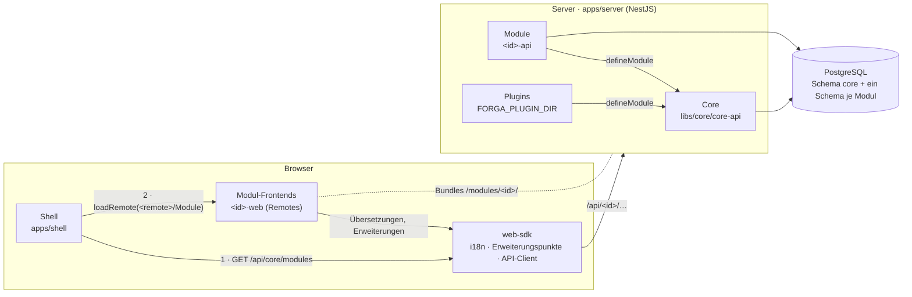
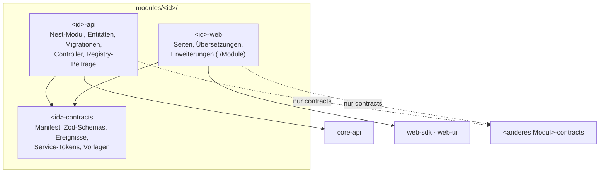
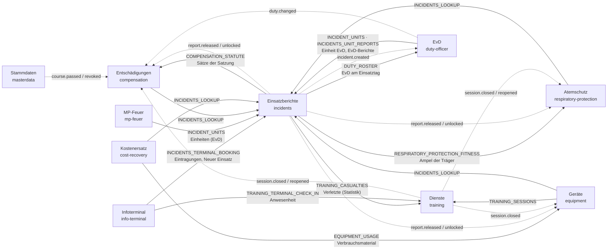
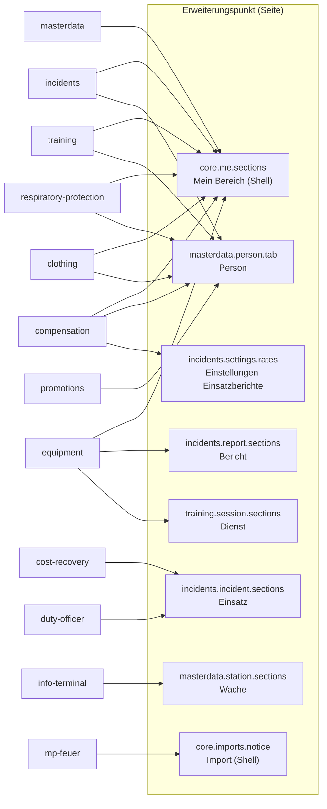

# Gesamtbild der Architektur

Dieses Dokument zeigt, welche Teile jedes Modul mitbringt und wo sie zusammenlaufen. Die Einzelheiten stehen in [architektur.md](architektur.md).

## Laufzeit

1. **Server-Start:** `installed-modules.ts` liefert die eingebauten Module, `loadPlugins` die geprüften Plugins.
   - `ForgaCoreModule.forRoot` sortiert die Module nach `requires` und bindet ihre Nest-Module ein.
   - `ormParts` gibt MikroORM die Entitäten und Migrationen aller Module.
   - Beim Start melden die Module in `onModuleInit` ihre Beiträge an die Registries des Core.
2. **Shell im Browser:** Sie holt die aktiven Module mit ihren Manifesten, also Name, Navigation, Rechte und `frontend` (`remote`, `exposed`).
   - Sie lädt jedes Frontend über Module Federation.
   - Übersetzungen und Erweiterungen landen in der gemeinsamen Instanz des `web-sdk` (auf `globalThis`).
3. **Zugriff:** Jede Anfrage geht an `/api/<id>/…`, der Core prüft Sitzung, CSRF und Rechte. Das Modul liest und schreibt nur sein eigenes Schema.

## Pakete eines Moduls

Module kennen einander nur über die `*-contracts`. Zur Laufzeit treffen sie sich an drei Stellen:

| Stelle | Richtung | Beispiel |
| --- | --- | --- |
| **Registries des Core** | Modul → Core | Listen, Fristen, Import, Suche, Einstellungen |
| **Service-Tokens** | Modul → Modul, synchron | Einsatzberichte fragen die Atemschutz-Tauglichkeit ab |
| **Ereignisse** (`DomainEvents`) | Modul → Modul, nach dem Commit | Freigegebener Bericht → Entschädigung, Gerätenutzung, Atemschutznachweis |

Im Frontend kommt eine vierte Stelle hinzu: die **Erweiterungspunkte**. Ein Modul blendet dort eigene Abschnitte in die Seiten eines anderen Moduls oder der Shell ein.

## Was jedes Modul mitbringt

| Modul | Hängt ab von | Entitäten (Schema) | Einstellungen | Listen | Importprofile |
| --- | --- | --- | --- | --- | --- |
| Stammdaten `masterdata` | – | Katalogeinträge, Abteilungen, Gruppen, Standorte, Fahrzeuge, Personen mit Mitgliedschaften, Qualifikationen, Dienstgraden, Ehrungen, Ämtern, Ruhezeiten, Lehrgänge mit Terminen, Teilnahmen und Meldungen | `masterdata.*` | 16 (Mitglieder, Geburtstage, Jubiläen, Qualifikationsmatrix …) | Personen, Werdegang |
| Einsatzberichte `incidents` | masterdata; optional equipment, respiratory-protection, compensation, cost-recovery, duty-officer | Alarmstichworte, Einsätze, Berichte mit Personal, Fahrzeugen, Beteiligten, anderen Kräften, Revisionen, Statistikjahre | `incidents.*` | 5 | Einsatzpersonal |
| Dienste `training` | masterdata; optional respiratory-protection, compensation | Dienstarten (Übungsdienst, Sonderdienst, Sonstiges), Dienste, Teilnahmen | `training.general` | 7 | Dienste |
| Atemschutz `respiratory-protection` | masterdata; optional incidents, training | Nachweise, Status | `respiratory-protection.rule` | 8 | Untersuchungen, Belastungsübungen |
| Entschädigungen `compensation` | masterdata; optional incidents, training, duty-officer | Auszahlungsläufe, Positionen, Funktionsträger | `compensation.general` | 2 | – |
| Geräte `equipment` | masterdata; optional incidents, training | Kategorien, Gerätetypen, Geräte, Prüfungen, Mängel, Verbrauch | `equipment.settings` | 6 | Bestand |
| Kostenersatz `cost-recovery` | masterdata, incidents; optional equipment | Bescheide, Adressbuch, Zuordnung Einsatz ↔ Tatbestand | `cost-recovery.general` | 5 | Zahlungen |
| Beförderungen `promotions` | masterdata | Beförderungslisten, Ausnahmen | `promotions.*` | 2 | – |
| Kleiderkammer `clothing` | masterdata | Artikel, Kleidungsstücke, Ausgaben, Pflege, Prüfungen, Größenprofile, Verbrauchsmaterial | `clothing.settings` | 2 | – |
| Einsatzleiter vom Dienst `duty-officer` | masterdata, incidents; optional compensation | Dienstplan, erwartete EvD-Berichte, Ausnahmen | `duty-officer.general` | 1 | Dienstplan (iCal) |
| Infoterminal `info-terminal` | masterdata, incidents; optional training | Terminals (Geräte an Wachen) | `info-terminal.general` | – | – |
| MP-Feuer `mp-feuer` | masterdata; optional incidents, training, respiratory-protection | Läufe, gelesene Zeilen je Profil, gemerkte Zuordnungen | `mp-feuer.remembered` | – | – (liest Transferdateien und gibt die Zeilen über `ImportService.runRows` an die Profile der anderen Module) |
| Datensicherung `backup` | – | Sicherungen und Wiederherstellungen (Protokoll, nicht historisiert) | `backup.general` | – | – |

Jedes Modul liefert außerdem ein Manifest mit Rechten, Rollenvorlagen und Navigation. Es meldet seine historisierten Entitäten, eine Migration `initial` und ein Frontend mit eigenen Übersetzungen.

## Zusammenlauf im Core

Die Module melden ihre Beiträge beim Start an die Registries des Core. Die Shell und die Endpunkte des Core fassen sie zusammen.

| Registry (Core) | Zusammengeführt in | masterdata | incidents | training | respiratory-protection | compensation | equipment | cost-recovery | promotions | clothing | duty-officer | info-terminal | mp-feuer | backup |
| --- | --- | :-: | :-: | :-: | :-: | :-: | :-: | :-: | :-: | :-: | :-: | :-: | :-: | :-: |
| `PermissionRegistry` (Manifest) | Rollen, Rechteprüfung | ● | ● | ● | ● | ● | ● | ● | ● | ● | ● | ● | ● | ● |
| Einstellungen (`settings`) | Verwaltung → Einstellungen, Einrichtungsliste | ● | ● | ● | ● | ● | ● | ● | ● | ● | ● | ● | ● | |
| `HistoryAccessRegistry` | Historie je Datensatz | ● | ● | ● | ● | ● | ● | ● | ● | ● | ● | ● | ● | |
| `ExportRegistry` | Vollexport | ● | ● | ● | ● | ● | ● | ● | ● | ● | ● | | | |
| `ListRegistry` | Listen (PDF, Excel, CSV) | ● | ● | ● | ● | ● | ● | ● | ● | ● | ● | | | |
| `DeadlineRegistry` | Aufgaben, Glocke, Sammel-E-Mail | ● | ● | ● | ● | ● | ● | ● | | ● | ● | | | ● |
| `ImportRegistry` | Import-Assistent, Läufe des Moduls MP-Feuer | ● | ● | ● | ● | | ● | ● | | | ● | | nutzt | |
| `SearchRegistry` | Globale Suche | ● | ● | ● | | | ● | ● | | ● | | | | |
| `CodeRegistry` | Code-Scan (Etiketten) | | | | | | ● | | | ● | | | | |
| `PersonDataRegistry` | Löschprüfung, Anonymisieren von Personen | ● (ruft auf) | ● | ● | ● | ● | ● | | ● | ● | ● | | ● | |
| `RetentionRegistry` | Aufbewahrungsplan, täglicher Lauf, Aussonderung | ● | ● | ● | | ● | ● | ● | | | ● | | ● | |
| `Notifications` | Sofortige E-Mails | | ● | | ● | | ● | | | | | | | ● |
| `OrganizationDirectory` | Rechte je Abteilung, Einrichtungsliste | stellt bereit | nutzt | | | | | | | | | | | |

## Zusammenlauf zwischen Modulen

Die Stammdaten sind die gemeinsame Grundlage. Alle anderen Module erhalten über Tokens aus `masterdata-contracts` Personen (`PERSON_DIRECTORY`) und die Organisation (`ORGANIZATION`). Sie melden Verweise zurück, damit die Stammdaten benutzte Einträge vor dem Löschen schützen:

| Token (masterdata) | Gemeldet von | Wirkung |
| --- | --- | --- |
| `CATALOG_REFERENCES` | incidents, respiratory-protection, compensation, equipment, promotions, duty-officer | Benutzte Katalogeinträge lassen sich nicht löschen |
| `ORGANIZATION_REFERENCES` | incidents, equipment, clothing, info-terminal | Benutzte Abteilungen, Standorte und Fahrzeuge lassen sich nicht löschen |
| `PERSON_HOLDINGS` | clothing | Austritt oder Wechsel in die Altersabteilung erst nach Rückgabe |

Die fachlichen Module verbinden sich über Service-Tokens (durchgezogen, synchroner Aufruf) und Ereignisse (gestrichelt, nach dem Commit).

Ein Pfeil zeigt vom Nutzer zum Anbieter (Token) bzw. vom Sender zum Empfänger (Ereignis). Tokens anderer Module werden mit `@Optional()` eingebunden: Ist das Modul nicht aktiv, entfällt die Funktion, der Nutzer läuft weiter.

Folgende Ereignisse werden gesendet, haben aber noch keinen Empfänger unter den eingebauten Modulen. Plugins können sie abonnieren:
- `masterdata.person.left`, `masterdata.person.qualification-changed`
- `respiratory-protection.status.changed`
- `equipment.item.status-changed`, `equipment.defect.reported`
- `compensation.run.completed`, `cost-recovery.notice.issued`, `promotions.list.executed`

## Zusammenlauf im Frontend

Die Shell stellt den Rahmen: Navigation aus den Manifesten, Startseite mit Aufgaben, Suche, Listen, Import, Verwaltung. Jedes Modul-Frontend bringt seine Seiten unter `/<id>/…` mit. Über Erweiterungspunkte erscheint es zusätzlich auf fremden Seiten:

Daneben gibt es Punkte innerhalb eines Moduls, z. B. `masterdata.import.ambiguous` und `cost-recovery.import.*` für Rückfragen im Import-Assistenten.

Ein Erweiterungspunkt erscheint nur, wenn das beitragende Modul aktiv ist und der Benutzer dessen Rechte hat. Deshalb zeigt z. B. die Personenseite je nach Installation andere Reiter.
